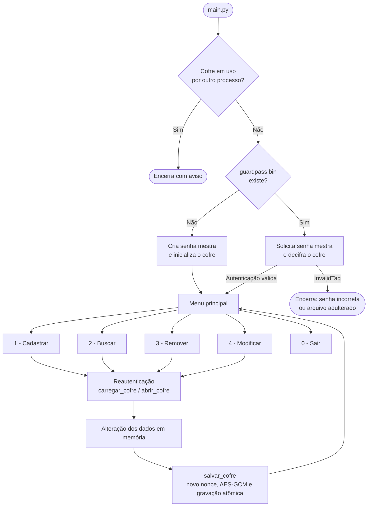

# GuardPass

Gerenciador de credenciais de linha de comando (CLI) com armazenamento local criptografado, desenvolvido em Python.

O GuardPass mantém as credenciais do usuário em um único arquivo binário (`guardpass.bin`), protegido por uma senha mestra. A chave de criptografia é derivada com **Argon2id** e os dados são protegidos com **AES-256-GCM**, que oferece confidencialidade e verificação de integridade. A aplicação opera totalmente offline: não há servidor, conta remota nem comunicação de rede.

**Status:** versão 1.1 | **Linguagem:** Python 3.14 | **Interface:** CLI | **Finalidade:** educacional

---

## Sumário

- [Visão geral](#visão-geral)
- [Funcionalidades](#funcionalidades)
- [Pré-requisitos](#pré-requisitos)
- [Instalação](#instalação)
- [Uso](#uso)
- [Referência do menu](#referência-do-menu)
- [Segurança](#segurança)
- [Formato do arquivo do cofre](#formato-do-arquivo-do-cofre)
- [Estrutura do repositório](#estrutura-do-repositório)
- [Arquitetura](#arquitetura)
- [Referência dos módulos](#referência-dos-módulos)
- [Limitações conhecidas](#limitações-conhecidas)
- [Versionamento e boas práticas](#versionamento-e-boas-práticas)
- [Roadmap](#roadmap)
- [Changelog](#changelog)
- [Contribuição](#contribuição)
- [Licença](#licença)
- [Autor](#autor)
- [Aviso legal](#aviso-legal)

---

## Visão geral

O projeto foi desenvolvido como trabalho acadêmico e tem como objetivo demonstrar a aplicação prática de conceitos de criptografia moderna em um utilitário funcional:

- derivação de chaves a partir de senha (KDF) com Argon2id;
- criptografia autenticada (AEAD) com AES-256-GCM;
- persistência atômica de dados;
- controle de concorrência por trava de arquivo (file lock);
- separação de responsabilidades em módulos.

---

## Funcionalidades

| Funcionalidade | Descrição |
|---|---|
| Inicialização do cofre | No primeiro acesso, solicita a criação e a confirmação da senha mestra e gera o arquivo cifrado. |
| Cadastro de credenciais | Registra aplicação/sistema, login, senha, data de criação e informações adicionais. |
| Gerador de senhas | Gera senhas aleatórias de 12 caracteres (letras, dígitos e símbolos) com o módulo `secrets`. |
| Consulta | Lista as entradas, exibe os metadados e permite exibir ou copiar a senha para a área de transferência. |
| Atualização | Permite alterar login, informações adicionais, senha e data de criação. |
| Remoção | Exclui uma entrada do cofre. |
| Expiração calculada | Define a validade da senha em 30 dias a partir da data de criação informada. |
| Instância única | Impede que o mesmo cofre seja aberto simultaneamente em mais de um processo. |
| Gravação atômica | Grava em arquivo temporário e o substitui ao final, reduzindo o risco de corrupção. |
| Reautenticação | Solicita a senha mestra a cada operação sensível. |

---

## Pré-requisitos

- **Python 3.14**

  O projeto utiliza o parâmetro `echo_char` de `getpass.getpass()` para mascarar a digitação com `*`. Esse parâmetro está disponível a partir do Python 3.14.

- Dependências de terceiros:

| Pacote | Finalidade |
|---|---|
| [`argon2-cffi`](https://pypi.org/project/argon2-cffi/) | Derivação de chave (Argon2id) |
| [`cryptography`](https://pypi.org/project/cryptography/) | Criptografia autenticada (AES-256-GCM) |
| [`pyperclip`](https://pypi.org/project/pyperclip/) | Acesso à área de transferência |
| [`filelock`](https://pypi.org/project/filelock/) | Trava de arquivo entre processos |

---

## Instalação

```bash
# Clonar o repositório
git clone https://github.com/<usuario>/GuardPass.git
cd GuardPass

# Criar e ativar um ambiente virtual (recomendado)
py -3.14 -m venv .venv
.venv\Scripts\activate          # Windows
# source .venv/bin/activate     # Linux / macOS

# Instalar as dependências
py -3.14 -m pip install argon2-cffi cryptography pyperclip filelock
```

Em Linux e macOS, substitua `py -3.14` por `python3.14`. No Linux, o `pyperclip` requer um utilitário de área de transferência instalado (`xclip`, `xsel` ou `wl-clipboard`).

---

## Uso

A partir da raiz do repositório (diretório que contém o `main.py`):

```bash
py -3.14 main.py
```

### Primeiro acesso

```text
Primeiro acesso ao GuardPass.
Crie sua senha mestra: ********
Digite a senha mestra novamente: ********
Cofre criado com sucesso!
```

### Acessos subsequentes

```text
Digite a senha mestra para entrar: ********

================================
           GuardPass
================================
1 - Cadastrar nova senha
2 - Buscar senha
3 - Remover senha
4 - Modificar senha
0 - Sair
Escolha uma opção:
```

> **Importante:** não existe mecanismo de recuperação da senha mestra. A perda da senha implica a perda definitiva do acesso aos dados do cofre.

---

## Referência do menu

### 1 - Cadastrar nova senha

1. Informar a senha mestra.
2. Informar o nome da aplicação ou sistema (identificador único; `0` retorna ao menu).
3. Informar o login.
4. Informar a data de criação da senha (`dd/mm/aaaa`). A data de expiração é calculada em +30 dias.
5. Informar observações adicionais (campo livre).
6. Gerar uma senha aleatória (`s`) ou informar uma senha manualmente (`n`).
7. Confirmar o cadastro.

Esquema de cada entrada:

| Campo | Descrição |
|---|---|
| `login` | Usuário ou e-mail da conta |
| `senha` | Senha da conta |
| `data_c` | Data de criação da senha |
| `data_e` | Data de expiração (`data_c` + 30 dias) |
| `infos` | Informações adicionais |
| `data_n` | Data em que a entrada foi registrada no GuardPass |

### 2 - Buscar senha

Lista as entradas cadastradas, exibe login, datas e observações da entrada selecionada e oferece as opções de exibir a senha no terminal e de copiá-la para a área de transferência. A entrada `0` retorna ao menu.

### 3 - Remover senha

Lista as entradas cadastradas e remove a entrada selecionada. A entrada `0` retorna ao menu.

### 4 - Modificar senha

Após selecionar a entrada, as seguintes operações estão disponíveis:

| Opção | Operação |
|---|---|
| 1 | Alterar login |
| 2 | Alterar informações adicionais |
| 3 | Alterar senha (exige a senha atual da entrada) |
| 4 | Alterar data de criação (recalcula a expiração) |
| 0 | Voltar |

### 0 - Sair

Encerra a aplicação.

---

## Segurança

### Visão do fluxo criptográfico

```text
 senha mestra ──> Argon2id + salt (16 B) ──> chave de 256 bits
                                                   │
 credenciais (JSON) ──> AES-256-GCM + nonce (12 B) ┴──> guardpass.bin
```

### Derivação de chave (KDF): Argon2id

A senha mestra nunca é utilizada diretamente como chave. Ela é processada pelo Argon2id, função resistente a ataques de força bruta com aceleração por hardware (GPU/ASIC), com os seguintes parâmetros:

| Parâmetro | Valor | Observação |
|---|---|---|
| Variante | `Argon2id` | Recomendada para derivação de chaves a partir de senhas |
| `time_cost` | 2 | Número de iterações |
| `memory_cost` | 65536 | Em KiB, equivalente a 64 MiB |
| `parallelism` | 2 | Número de lanes |
| `hash_len` | 32 bytes | Chave de 256 bits |
| `salt` | 16 bytes | Gerado com `secrets.token_bytes` na criação do cofre |

### Criptografia autenticada (AEAD): AES-256-GCM

- O conteúdo do cofre (dicionário serializado em JSON) é cifrado com AES-256 no modo GCM, que garante confidencialidade e integridade.
- Um nonce de 12 bytes, aleatório e inédito, é gerado a cada gravação.
- Em caso de senha incorreta ou de adulteração do arquivo, a decifragem falha com `InvalidTag` e a aplicação informa o erro sem expor dados.

### Controles adicionais

- Entrada de senhas via `getpass`, sem eco do texto digitado.
- Geração de senhas com `secrets`, fonte de aleatoriedade criptograficamente segura.
- Gravação atômica: os dados são escritos em `guardpass.tmp` e movidos para `guardpass.bin` por `Path.replace()`.
- Trava de arquivo (`guardpass.lock`): uma segunda instância recebe a mensagem "Este cofre já está aberto em outra janela."

---

## Formato do arquivo do cofre

O arquivo `cofre/guardpass.bin` possui layout binário fixo:

```text
┌──────────────┬──────────────┬─────────────────────────────────┐
│  salt        │  nonce       │  ciphertext + tag de autenticação│
│  16 bytes    │  12 bytes    │  tamanho variável (mín. 16 B)   │
└──────────────┴──────────────┴─────────────────────────────────┘
```

Estrutura do documento JSON antes da cifragem:

```json
{
  "GitHub": {
    "login": "usuario@email.com",
    "data_c": "01/11/2026",
    "data_e": "01/12/2026",
    "infos": "Conta pessoal",
    "senha": "********",
    "data_n": "21/11/2026"
  }
}
```

---

## Estrutura do repositório

```text
GuardPass/
├── main.py                    # Ponto de entrada: trava, autenticação e loop principal
├── Menus/
│   └── menu.py                # Renderização do menu principal
├── cofre/
│   ├── cofre_definitivo.py    # Camada criptográfica: criação, leitura e gravação do cofre
│   └── guardpass.bin          # Cofre cifrado (gerado em tempo de execução)
├── funções/
│   ├── portaria_cofre.py      # Inicialização e autenticação com a senha mestra
│   ├── criar_senha.py         # Operação 1: cadastro e geração de senha
│   ├── buscar_senhas.py       # Operação 2: consulta, exibição e cópia
│   ├── remover_app.py         # Operação 3: remoção
│   └── modificar_senha.py     # Operação 4: atualização
├── testes/
│   ├── teste_cadastro.py      # Script experimental de cadastro e cifragem
│   └── cofre                  # Versão anterior do módulo de cofre (referência)
├── .gitattributes
└── README.md
```

---

## Arquitetura



### Camadas

1. **Interface (CLI):** `main.py` e `Menus/menu.py`.
2. **Regras de negócio:** módulos em `funções/`, um por operação.
3. **Camada criptográfica e de persistência:** `cofre/cofre_definitivo.py`, único módulo responsável por Argon2id, AES-GCM e pelo formato do arquivo.

---

## Referência dos módulos

### `cofre/cofre_definitivo.py`

| Símbolo | Descrição |
|---|---|
| `ARQUIVO_COFRE` | Caminho do arquivo `guardpass.bin`, localizado junto ao módulo. |
| `gerar_chave(senha_mestre, salt)` | Deriva a chave de 32 bytes com Argon2id. |
| `criar_cofre(senha_mestre)` | Cria um cofre vazio e cifrado. Falha se o arquivo já existir (modo `xb`). |
| `carregar_cofre(senha_mestre)` | Lê e decifra o cofre. Retorna `(credenciais, chave, salt)`. Pode lançar `InvalidTag` ou `ValueError`. |
| `abrir_cofre(senha_mestre)` | Retorna apenas o dicionário de credenciais. |
| `salvar_cofre(credenciais, chave, salt)` | Cifra com um novo nonce e grava de forma atômica. |

### `funções/portaria_cofre.py`

| Símbolo | Descrição |
|---|---|
| `iniciar_guardpass()` | Executa o fluxo de inicialização (criação e confirmação da senha mestra) ou de autenticação. Retorna as credenciais. |

### `funções/criar_senha.py`

| Símbolo | Descrição |
|---|---|
| `add_nova_senha(credenciais)` | Cadastro com validação de identificador único, validação de data e gerador de senha opcional. |

### `funções/buscar_senhas.py`

| Símbolo | Descrição |
|---|---|
| `buscar_senhas(credenciais)` | Listagem, detalhamento, exibição e cópia da senha. |

### `funções/remover_app.py`

| Símbolo | Descrição |
|---|---|
| `remover_apps(credenciais)` | Remove uma entrada e persiste a alteração. |

### `funções/modificar_senha.py`

| Símbolo | Descrição |
|---|---|
| `modificar_senhas(credenciais)` | Atualiza login, informações adicionais, senha e data de criação. |

### `Menus/menu.py`

| Símbolo | Descrição |
|---|---|
| `exibir_menu(credenciais)` | Imprime o menu principal. |

---

### Backup e restauração do cofre
O GuardPass armazena todas as credenciais no arquivo cofre/guardpass.bin, criado no primeiro uso. A cópia desse arquivo contém os dados salvos até o momento do backup e permanece criptografada com a senha mestra do cofre.

Fazer backup
1. Feche o GuardPass pela opção 0 - Sair.
2. Copie cofre/guardpass.bin para um local privado fora da pasta do projeto, como um pendrive. Repita a cópia após alterações que deseja preservar.
Restaurar um backup
1. Com o GuardPass fechado, abra a pasta cofre/ da instalação de destino. Se já houver um guardpass.bin, guarde uma cópia dele antes de continuar. A restauração substitui todas as credenciais da instalação pelas da cópia escolhida.
2. Coloque o arquivo de backup nessa pasta com o nome guardpass.bin.
3. Execute python main.py na raiz do projeto e digite a senha mestra usada no cofre do backup. Use a opção 2 - Buscar senha para conferir uma credencial restaurada.

---

## Limitações conhecidas

Por se tratar de um projeto acadêmico, aplicam-se as seguintes limitações:

- **Sem recuperação da senha mestra.** A perda da senha implica a perda dos dados.
- **Segredos em memória.** As senhas são protegidas em repouso (em disco), mas permanecem em texto claro na memória do processo durante a execução.
- **Área de transferência.** O conteúdo copiado não é limpo automaticamente e permanece disponível até ser substituído.
- **Exibição no terminal.** Senhas exibidas na tela podem permanecer no histórico de rolagem do terminal.
- **Sem limitação de tentativas.** Não há bloqueio após tentativas sucessivas de senha incorreta; a proteção se restringe ao custo computacional do Argon2id.
- **Expiração apenas informativa.** A data de expiração é calculada e exibida, mas não gera alertas.
- **Remoção sem confirmação.** A entrada é excluída imediatamente após a seleção.
- **Sem backup automático** do arquivo do cofre.
- **Ausência de testes automatizados.** O diretório `testes/` contém scripts experimentais do desenvolvimento.
- **Ponto de entrada.** No `main.py`, o bloco `try/with FileLock` está fora da condição `if __name__ == "__main__":`, o que faz a aplicação iniciar também em caso de importação do módulo. Correção pendente.

---

## Versionamento e boas práticas

O repositório não possui `.gitignore`. Arquivos de dados do usuário e artefatos de execução não devem ser versionados. Adicione na raiz:

```gitignore
# Dados do usuário e artefatos de execução
cofre/*.bin
cofre/*.tmp
cofre/*.lock
testes/*.bin

# Python
__pycache__/
*.pyc
.venv/
```

Caso o cofre já tenha sido incluído em algum commit, o `.gitignore` por si só não o remove do versionamento:

```bash
git rm --cached cofre/guardpass.bin
git rm -r --cached __pycache__ */__pycache__
git commit -m "chore: remove cofre e cache do versionamento"
```

Se um cofre real tiver sido publicado em um repositório público, considere-o comprometido: crie um novo cofre com outra senha mestra e substitua as credenciais nele armazenadas. Remover o arquivo do histórico completo exige ferramentas específicas, como `git filter-repo`.

---

## Roadmap

- [ ] Limpeza automática da área de transferência após intervalo configurável
- [ ] Alertas de expiração de senhas
- [ ] Confirmação antes da remoção de entradas
- [ ] Alteração da senha mestra
- [ ] Parâmetros configuráveis no gerador de senhas (tamanho e conjunto de caracteres)
- [ ] Exportação, importação e backup do cofre
- [ ] Bloqueio temporário após tentativas de autenticação malsucedidas
- [ ] Testes automatizados com `pytest`
- [ ] Arquivo `requirements.txt`
- [ ] Correção do bloco de entrada em `main.py`
- [ ] Interface gráfica

---

## Changelog

| Versão | Descrição |
|---|---|
| 1.1 | Gerador de senhas, trava de instância única, melhorias nos menus e nas operações. |
| 1.0 | Primeira versão funcional: cadastro, consulta, remoção e atualização. |
| Pré-1.0 | Prototipação da chave mestra e do cofre criptografado (Argon2id e AES-GCM). |

---

## Autor

**Jud** - [@JudGB](https://github.com/JudGB)

---

## Aviso legal

Este software é fornecido para fins educacionais, "no estado em que se encontra", sem garantias de qualquer natureza. Não foi submetido a auditoria de segurança independente e não é recomendado para a proteção de credenciais críticas. Para esse fim, utilize soluções consolidadas e auditadas.
